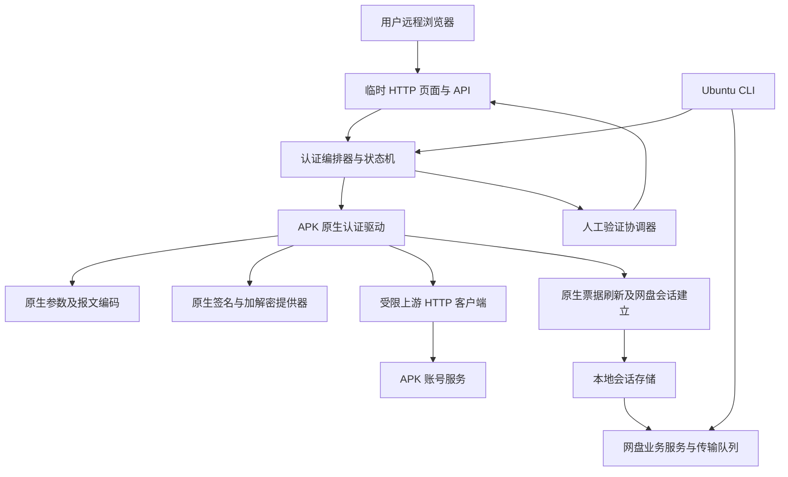
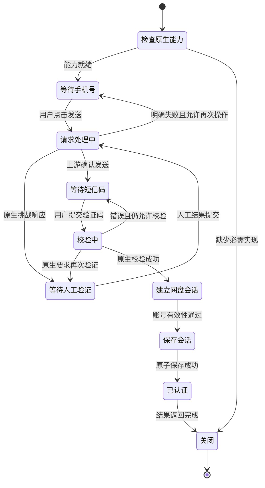

# Ubuntu CLI：APK 原生短信认证与临时 HTTP 交互架构

状态：架构草案，可据此分阶段实现；不是已完成的原生短信客户端。

## 1. 目标与边界

- Ubuntu CLI 是主程序。登录仅手机号 + 短信验证码，允许人工完成 APK 原生流程要求的安全验证。
- 默认流程是“输入手机号 → 用户点击获取验证码 → 填写短信码 → 建立网盘会话”，不预设图形/滑块验证为必经步骤。终端可直接完成正常交互；需要远程页面时显式选择 HTTP UI。
- 登录期间可短时监听 `0.0.0.0:80`，用户通过远程浏览器输入手机号、操作安全验证并填写验证码。端口、外部访问地址与有效期均可配置。
- 页面只提供交互；后端认证只依据目标 APK 恢复的原生请求、签名、加解密与会话流程。原 `sms-only-login` 分支的网页认证实现不作为依据，不作为回退。
- 登录完成、取消、超时或不可恢复错误后关闭监听。网盘命令执行时不需要常驻 Web 服务。
- 登录后需要账号与容量、目录列表/分页、ls/cd/pwd/refresh、文件和递归目录上传下载、新建/重命名/删除、退出登录。多文件下载默认并发 3。
- 当前阶段不处理具体平台公网、防火墙、SSH 或预览入口配置。

## 2. 模块与依赖方向



依赖约束：网盘业务模块不依赖 UI；原生驱动不依赖 HTML、浏览器状态或网页登录 Cookie。CLI 与 HTTP 只调用同一个认证编排器，不能各自维护一套认证逻辑。UI 永远拿不到服务票据、网盘 Cookie 或长期凭据。

| 模块 | 职责 | 禁止承担的职责 |
| --- | --- | --- |
| `auth-flow` | 生命周期、状态转换、互斥、取消、超时、用户事件 | 猜测原生端点、实现签名算法 |
| `auth-native` | APK 方法、请求/响应、错误分类与票据流程 | 读取旧网页登录状态、自动替代认证方式 |
| `native-codec` | 排序、签名输入、表单编码、已恢复的报文封装 | 生成假签名、假成功 |
| `native-crypto` | 根据已恢复实现进行签名、加密和解密 | 无实现时回退空签名或明文发送 |
| `challenge` | 保存一次验证上下文、向 UI 提供交互描述、接收人工结果 | 自动解题、脱离原生上下文复用验证结果 |
| `login-ui` | 本地静态资源、临时 HTTP API、渲染当前交互 | 直接访问账号服务、持久化手机号/验证码 |
| `session-store` | 验证后的认证材料、原子写入、恢复/轮换、退出清理 | 把服务票据直接标记为网盘登录成功 |
| `drive-service` | 文件管理与传输调度 | 假定原生登录材料必然兼容现有网页接口 |

模块先保持在现有 Rust workspace 内；出现独立编译/复用需求再拆 crate，不为架构图提前创建空 crate。

## 3. 登录生命周期

1. CLI 检查原生驱动的必要能力：发送/校验、签名、加解密和会话建立是否已实现。挑战处理属于条件能力，不因正常流程没有挑战而强行引入网页组件。缺少必要能力时输出明确阻塞项，不开放可提交真实信息的页面。
2. 创建独立登录事务，设置绝对截止时间，产生至少 256 bit 随机访问凭证。
3. 启动 HTTP 监听，终端输出短期访问链接。将访问凭证放在 URL fragment，避免进入普通 HTTP 访问日志。页面读取后从地址栏移除，只保留内存。
4. 页面凭此凭证领取唯一控制会话，之后凭短期内存令牌调用 API；第二个浏览器不能接管同一事务。刷新/丢失会话后的恢复方式必须显式设计，不暗中重复发短信。
5. 用户填手机号并主动点击发送。编排器校验状态与冷却时间，再调用原生驱动。没有成功发送响应，不提示“短信已发送”。
6. 原生服务要求人工验证时，进入对应挑战状态。用户完成后，协调器将结果与当前事务绑定，继续 APK 规定的下一步。验证成功不等于短信发送成功。
7. 服务确认发送后，允许填写验证码。点击登录后按原生协议校验，再刷新/交换票据，建立网盘会话。
8. 使用新认证材料执行最小账号有效性检查，成功后原子保存会话。保存失败不能显示“已保存登录”。
9. 向页面返回脱敏结果，响应完成后在有限宽限期内关闭监听并销毁登录事务；最终结果由终端同时报告。失败、取消、超时也清理监听和内存中的短期数据。

浏览器意外关闭不自动发送/重试。事务继续受原始截止时间约束，CLI 可 Ctrl+C 取消。



所有活动状态均可因绝对超时、CLI 取消或致命错误进入关闭。挑战上下文必须记录“来自哪个步骤”，结束后回到该步骤，不能一律当作发送短信前验证。

## 4. 临时 HTTP API（本程序内部协议）

以下路径是新设计的本地交互 API，不是从 APK 恢复的上游地址。

| 方法与路径 | 用途 | 约束 |
| --- | --- | --- |
| `GET /` | 提供自带静态页面 | 不包含账号状态和凭据；不加载分析/广告脚本 |
| `POST /api/claim` | 访问凭证换唯一控制令牌 | 常量时间验证；单次领取；仅 JSON |
| `GET /api/state` | 读取状态、剩余时间、脱敏提示 | 控制令牌必需；不可返回验证码或票据 |
| `POST /api/send-code` | 请求发送短信 | 手机号在 JSON body；用户显式操作；禁止自动重试 |
| `GET /api/challenge` | 获取当前人工挑战描述 | 只读当前事务；不能由客户端指定任意上游 URL |
| `POST /api/challenge/complete` | 提交人工操作结果 | 校验 challenge ID、步骤、期限、单次使用 |
| `POST /api/verify-code` | 提交短信验证码 | 仅发送已确认的事务允许；提交后清空页面输入框 |
| `POST /api/cancel` | 取消事务并关闭 | 幂等；取消并传播到在途上游请求 |

状态响应建议包含 `state`、`expires_in`、`retry_after`、`allowed_actions`、脱敏 `message`，不返回内部错误对象。POST 的 `action_id` 用于本事务内去重：重复网络提交返回已记录结果，不能再次向上游发送短信。去重结果只留必要状态，不保留含手机号/验证码的请求 body。

所有接口限制请求体大小；拒绝非 JSON 写请求；控制令牌通过 Authorization 头传递。禁止跨域开放 CORS，写操作核对配置的公开 Origin。反向代理部署时明确配置外部 Origin，不盲目信任任意 X-Forwarded-* 头。前端通过文本节点显示上游提示，不插入任意上游 HTML。

同一事务采用单写者队列串行处理变更；状态读取使用快照。外部动作重复、旧 challenge、错误状态、超时与发送冷却分别返回稳定错误码；上游网络超时属于结果不确定，禁止自动重发。

## 5. 人工验证：保持原生语义

用户提供 App 手机号页面，并报告点击获取验证码没有触发安全验证。这是用户提供的该次运行观察，支持将普通短信流程作为默认；不能据此保证所有设备/网络永远不触发风控。截图包含真实手机号，不提交到源码或公开研究包。

旧网页的滑块行为不作为 App 的证据。不能事先将 APK 验证机制定为网页滑块。已观察到原生发送请求具有可选 `captcha_id`、`captcha_code`；挑战的生成、展示与提交全链路尚未恢复。

`ChallengeDriver` 的输出按实际证据确定：可能是图片/文字输入，也可能需要官方组件。只有 APK 确认使用的交互协议/组件才能接入。若依赖 Android 专属组件，先记录为平台依赖并返回“当前不支持”，不自行构造一个看似可用的滑块。

UI 负责展示和收集人工结果，驱动负责校验格式、关联和时效。原生驱动可以产生事件：

```text
NeedPhone
ChallengeRequired { challenge_id, presentation, resume_step }
SmsSent { retry_after, code_constraints }
VerificationRejected { retry_policy }
EstablishingSession
Authenticated
Failed { public_code, sanitized_message }
```

验证码位数、过期时间、重试次数来自已恢复的原生约束/响应；没有证据时不沿用旧网页的 4 位码等配置。人工输入不能代替 SecurityGuard 签名与报文加密。

## 6. 端口、寿命与数据处理

计划命令形态（尚未实现，不是当前可执行说明）：

```bash
quark-probe login --ui http \
  --listen 0.0.0.0:80 \
  --public-url http://SERVER \
  --ttl 600
```

`--public-url` 用于生成地址和校验来源；不自动修改云防火墙。端口占用、无低端口权限或缺少原生能力时，应在收集个人信息前失败。监听低端口可以由服务管理器/反向代理处理，不要求整个 CLI 以 root 运行。

用户指定的 HTTP 模式可保留；HTTP 不加密手机号和验证码，短时开放与随机访问凭证不会改变这一点。有条件的环境通过 HTTPS 入口反向代理到临时服务，凭据页禁用缓存和引用来源，不加载外部统计资源。

不在浏览器 localStorage/sessionStorage、URL query、研究材料、调试日志和错误堆栈中保存手机号、验证码、挑战证明、票据或 Cookie。响应均 no-store。内存中的短期秘密在关闭时释放并尽可能清零；不能把普通字符串释放描述为已保证清零。

真实认证成功后才写 session-store，目录 0700、文件 0600、原子替换；logout 清除保存的会话。服务票据与网盘认证材料使用不同类型，避免误把前者交给网盘客户端。

## 7. 原生协议的已知与未知

依据固定 APK：QuarkCloudDrive 10.20.5.142，SHA-256 `e32e25409ff5d278bfce2f264af03e1e2d495c503ca5673c391955a390c7eeb7`。以下均为静态证据，不是线上成功记录。

已知：

- 发送操作 `cas.sendSmsCodeForLogin`；校验操作 `cas.loginWithSmsCode`。
- 原生公共参数包含 client_id 636、设备与请求上下文；不得替换为网页参数。
- 签名输入是排序参数的 key=value 无分隔拼接，之后生成 sign，再对值作 Java URLEncoder 编码。
- 签名依赖 SecurityGuard requestType=3，具有额外输入后缀和两字节十六进制前缀；并非已恢复成通用哈希。
- 加密依赖 SecurityGuard staticBinarySafeEncryptNoB64；已知封装不代表算法和密钥已恢复。
- EncryptModel 默认模式 20030，另有 20031；这些是模式/密钥选择标识，不是实际密钥。
- 短信成功后调用原生票据刷新，接着发布 ACCOUNT_LOGIN_SUCCESS；刷新不是已证实的网盘会话兑换。

待解决：

1. 原生 SDK 初始化、appKey/authCode 来源、设备上下文的真实必要性。
2. 签名/加解密在 Ubuntu 独立运行的实现与一致性样本。
3. 人工挑战的触发条件、生命周期及呈现方式（条件分支，不作为正常短信发送的前置步骤）。
4. ACCOUNT_LOGIN_SUCCESS 的网盘消费者与原生会话材料。
5. 原生登录材料与文件接口的兼容性、轮换/失效规则。

`native-crypto` 的可替换接口用于隔离这些未知，不意味着实现已经存在。没有原生 provider 时不绑定真实提交入口，不退回网页登录或空签名。

## 8. 实现顺序与验收

1. **协议恢复**：原生发送/校验、挑战、签名/加解密、票据消费全部有证据与明确未知；不重跑已完成分析。
2. **离线编码与状态机**：根据静态样本验证排序、编码与封装；用模拟驱动测试操作去重、错误状态、冷却、取消、过期与清理。
3. **临时交互层（可选 UI）**：接同一个编排器，验证单次领取、Origin/令牌、浏览器断开、超时、端口冲突、JSON 体限制与自动关服。模拟服务必须明确标识为模拟，不能对真实号码声称发送。
4. **原生集成**：提供器就绪后再开放真实手机号表单，进行授权的一次短信测试；仅当原生响应确实要求时人工处理挑战。验证会话有效且可恢复。
5. **网盘验证**：账号/分页/目录进退/刷新、新建/重命名/回收站、单文件及 5 级目录往返校验；验证默认多文件下载并发为 3。测试数据置于独立目录，不删除用户文件。
6. **Ubuntu 交付**：22.04/24.04 构建、帮助与文档对应新命令；移除旧认证入口及无用依赖。只有上述真实验证通过才标记可用版本。

当前可继续完成协议恢复、离线编码和架构设计，不需要先解决当前平台的公网入口。
